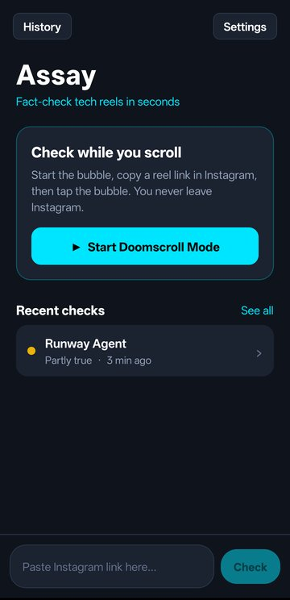
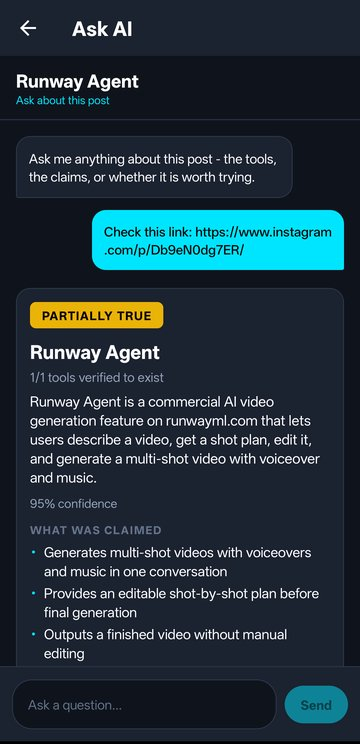
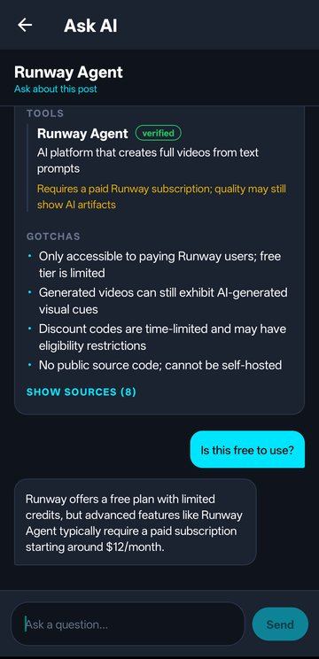

# 🔍 Assay — fact-check tech reels while you scroll

Instagram is full of reels like *"this free AI tool replaces your whole team"* or *"comment GUIDE and I'll send you the repo"*. **Assay** is an Android app that checks them for you: tap a floating bubble on any reel or post and get a verdict — **True, Partly true, Hype, Misleading or Fake** — with every claim and tool checked against the web.

<p align="center">
  
  &nbsp;
  
  &nbsp;
  
</p>

---

## ✨ What it does

* **Checks while you scroll** — start Doomscroll Mode, copy a reel link in Instagram, tap the bubble. You never leave Instagram; a notification brings the verdict.
* **Or paste a link** — any Instagram reel or post (including multi-slide posts and lists of tools).
* **Reads everything** — the caption, the speech (any language, translated to English) and the text on screen.
* **Checks every claim** — looks up each tool, repo and promise on the web and reports which tools are real, what is true and what is hype.
* **Ask AI** — ask follow-up questions about any post, like *"Is this free?"*
* **Knows its lane** — non-tech posts are labelled *Not a tech post* instead of getting a made-up verdict.
* **Free to run** — uses one free [Groq](https://console.groq.com) API key. No account, no ads, no tracking; your history stays on your phone.

## 📲 Install

1. Download the latest APK from [Releases](https://github.com/Ayushsri242/Instagram-Tech-Fact-Checker/releases/tag/verified-production) and install it (allow *install from unknown sources*).
2. Open Assay and follow the short setup: get a free Groq key, allow the bubble and notifications.
3. The app updates itself — it tells you when a new version is out.

## 🏗️ How it works

```
 Instagram reel / post
        │  (bubble or pasted link)
        ▼
 Fetch the post ──► caption · speech (Whisper) · on-screen text
        │
        ▼
 Reader model ──► what is claimed, which tools are named
        │
        ▼
 Web search ──► evidence for each tool and claim
        │
        ▼
 Judge model ──► verdict, confidence, gotchas, sources
        │
        ▼
 Notification · report · Ask AI  (saved on the phone)
```

## 🛠️ Tech stack

| Part | Built with |
| :--- | :--- |
| App | React Native (Expo) + native Kotlin modules |
| Floating bubble | Android overlay service with a background job queue |
| Speech | Groq Whisper (with translation for non-English speech) |
| Reasoning | Groq-hosted open models (a reader and a judge) |
| Web evidence | DuckDuckGo with a Bing fallback, GitHub lookups |
| Storage | On-device only |
| Builds & updates | GitHub Actions → GitHub Releases → in-app updater |

The repository also holds the earlier desktop prototype (Python + Streamlit) and an older native Android experiment (`android_app/`); the current app is in `mobile_app/`.

## 📜 License

[PolyForm Noncommercial 1.0.0](LICENSE.md) — you are free to read, learn from, run and modify this code for **personal, research and other non-commercial** use. Commercial use is not permitted without permission.

Copyright © 2026 Ayushya Shrivastav.
